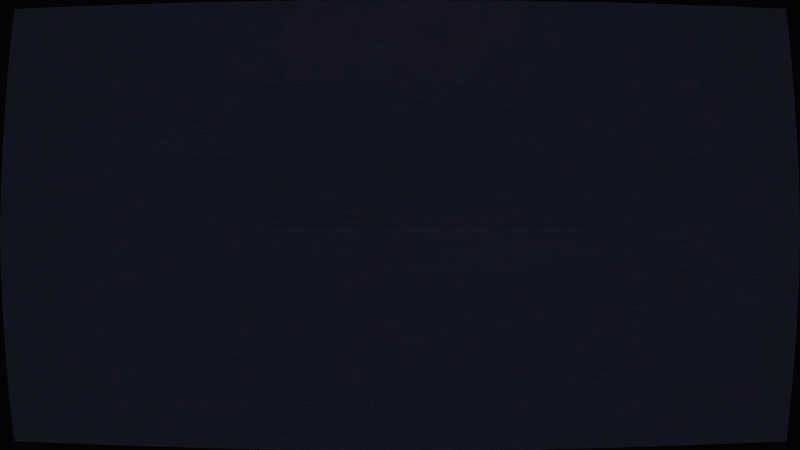
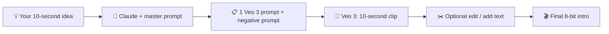

# 👾 8-Bit Pixel AI Video Kit

**Turn any idea into a 10-second, retro 8-bit motion-graphics intro using Claude + Gemini Veo 3.**

---

## ✨ What is this?

A tiny kit with everything you need to make fast, glitchy, arcade-style intro videos with AI:

👾 **Chunky pixel art** · 📺 **CRT scanlines + glitch** · ⚡ **Kinetic text** · 🪙 **Coins, parachutes, bouncing balls**

Paste one master prompt into Claude, GPT or Gemini, type a one-line idea, and get a ready-to-use Veo 3 prompt. Every run gives a different palette, world, transitions, text style and soundtrack, so no two videos look the same.

---

## 📂 What's inside

| File | What it is |
| ---- | ---------- |
| 📝 [**prompt.md**](prompt.md) | The master prompt. Paste it into Claude, GPT or Gemini, then send your 10-second idea. It returns one Veo 3 prompt and a negative prompt. |
| 🍳 [**recipe.md**](recipe.md) | The exact workflow: idea → master prompt → Veo 3 → 10-second intro. Includes fully styled example prompts, a 30-second variant and troubleshooting. |
| 🎞️ [**demo.gif**](demo.gif) | A pixel-art preview of the style. |
| ⚖️ [**LICENSE**](LICENSE) | MIT. Use it, remix it, share it. |

---

## 🔁 How it works

---

## 🚀 Quick start

1. 📝 Open [`prompt.md`](prompt.md) and copy the master prompt.
2. 🤖 Paste it into Claude, GPT or Gemini as the first message (or as a system prompt / custom GPT / Gem).
3. 💬 Send your idea in one line, for example: `Intro for my fitness YouTube channel FITZONE`.
4. 📋 Copy the prompt it gives you into Veo 3. Paste the negative prompt too if your tool has that field.
5. ✂️ Optional: fix any garbled text in CapCut, DaVinci Resolve or Premiere.

Want the full step-by-step? Read the [**recipe**](recipe.md).

---

## 🎨 The style

| Element | Look |
| ------- | ---- |
| 👾 Pixels | Hard-edged NES/arcade pixel art, no anti-aliasing, no smooth gradients |
| 📺 Screen | CRT scanlines, slight curvature, chromatic aberration, VHS glitch |
| ⚡ Text | Short UPPERCASE chunky pixel text, 3-4 words per hit, kinetic reveals |
| 🎞️ Motion | A new visual event every 0.3-0.5 seconds, screen shake on beats |
| 🎵 Audio | Chiptune with synced coin, whoosh and glitch effects |
| 🎨 Palette | Changes every run. Example: Charcoal `#131311` · Neon Green `#39FF14` · Cyan `#00E5FF` · Magenta `#FF2BD6` · Gold `#FFD100` |

---

## 🎲 Why every video is different

The master prompt includes a **variation engine** with 11 pools: palette, world, structure, opening hit, transitions, text styles, sprites, movers, screen FX, closing and audio. Each run picks a fresh combination, and "again" changes at least 8 of the 11, so you can generate endless unique intros from the same idea.

---

## 🧰 Works with

| Tool | Output you get |
| ---- | -------------- |
| 🎥 **Gemini Veo 3** | One 10-second prompt with audio direction |
| 🧠 **Claude / GPT / Gemini** | Runs the master prompt |
| ✂️ **CapCut / DaVinci / Premiere** | Optional text fixes and clip joining |

---

## 💬 Join the community

### Want more digital stuff, templates and AI tips?

### 🌐 Visit our website: [**mughal.dev**](https://mughal.dev)

---

## ⭐ Support

If this kit helped you, give the repo a **star** ⭐ and share it with someone who makes videos.

Made with ❤️ by **[mughal.dev](https://mughal.dev)**
